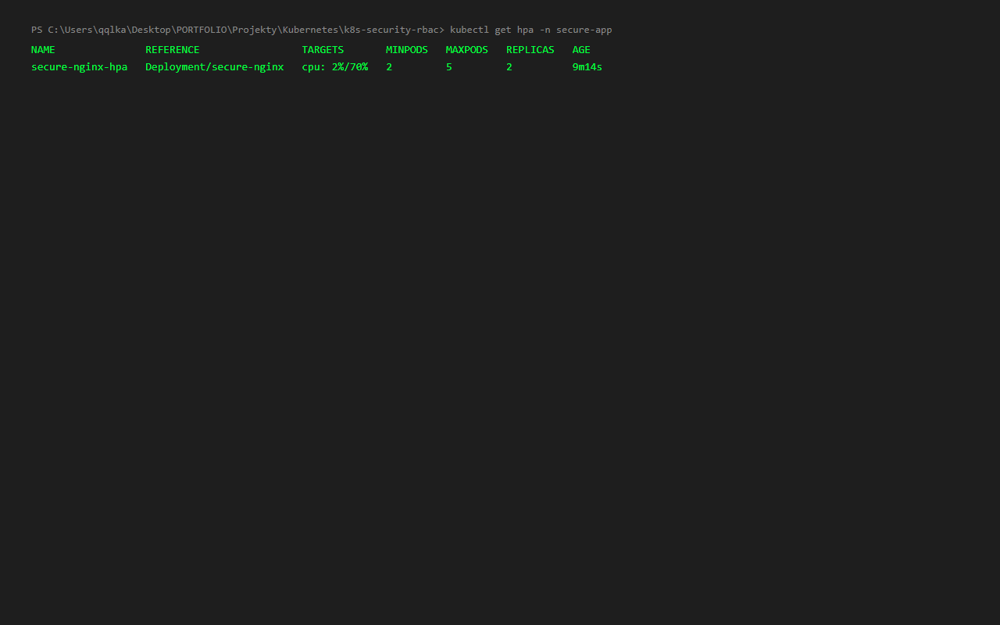

# ☸️ Kubernetes Security & RBAC Lab

[](https://kubernetes.io)
[](https://minikube.sigs.k8s.io)
[](https://kubernetes.io/docs/reference/access-authn-authz/rbac/)
[](https://opensource.org/licenses/MIT)

A security-hardened Kubernetes deployment demonstrating namespace isolation, RBAC least-privilege access control, encrypted Secret management, and NetworkPolicy enforcement on a local Minikube cluster.

This project goes beyond a basic "get something running" tutorial — it implements the security controls a real infrastructure or DevSecOps engineer would apply before pushing a workload to production: scoped service accounts, deny-all network policies, secret injection without environment variable leakage, and HPA-backed autoscaling — all defined as version-controlled manifests.

---

## 🎯 Objective

The goal is to build a **defence-in-depth Kubernetes environment** that demonstrates how multiple security layers interact in practice. Rather than relying on default permissive settings, this lab configures explicit RBAC roles scoped to the minimum required API verbs, a NetworkPolicy that denies all ingress by default and only opens port 80 for the nginx pods, and Secrets injected at runtime via `secretKeyRef` — never hardcoded in manifests or container images. Every control is implemented, deployed, and verified against a live cluster.

---

## ✨ Key Features

- **Namespace Isolation:** All workloads run inside the `secure-app` namespace, preventing lateral movement to other namespaces by default.
- **Least-Privilege RBAC:** A dedicated `app-service-account` is bound to a Role that allows only `get` and `list` on pods and configmaps — nothing else.
- **ClusterRole Separation:** A separate `viewer-account` is bound to a read-only ClusterRole scoped to nodes and namespaces, demonstrating Role vs ClusterRole boundaries.
- **Secret Injection:** `DB_PASSWORD` is pulled from a Kubernetes Secret at pod startup via `secretKeyRef` — the raw value is never visible in the manifest or container spec.
- **Default-Deny NetworkPolicy:** A `deny-all-ingress` policy blocks all inbound traffic to the namespace; a second policy selectively opens port 80 only to pods labelled `app: secure-nginx`.
- **HPA Autoscaling:** HorizontalPodAutoscaler maintains between 2 and 5 replicas, scaling on CPU utilisation at 70% threshold.
- **Resource Governance:** Each container has explicit CPU and memory requests and limits, preventing noisy-neighbour resource exhaustion.
- **Health Probes:** Readiness and liveness probes on `/` port 80 ensure traffic is only routed to containers that have passed startup validation.

---

## 🛠️ Tech Stack

| Layer | Technology |
|---|---|
| Container Orchestration | Kubernetes 1.35 (Minikube) |
| Container Runtime | Docker (Minikube driver) |
| Workload | nginx:1.25-alpine |
| Access Control | Kubernetes RBAC — Role, ClusterRole, RoleBinding, ClusterRoleBinding |
| Secret Management | Kubernetes Secrets (Opaque type) — `secretKeyRef` injection |
| Configuration | Kubernetes ConfigMap — `configMapKeyRef` injection |
| Network Security | Kubernetes NetworkPolicy — default-deny + selective allow |
| Autoscaling | HorizontalPodAutoscaler (autoscaling/v2) |
| Metrics | metrics-server addon (required for HPA CPU targeting) |

---

## 🏗️ Architecture

All resources live in the `secure-app` namespace. Inbound traffic enters via a NodePort Service, which the Kubernetes kube-proxy forwards to pods matched by the `app: secure-nginx` label. The `deny-all-ingress` NetworkPolicy drops all traffic at the namespace level; the `allow-nginx-ingress` policy punches a hole for TCP port 80 to those same pods. Each pod runs under `app-service-account`, which is bound to `app-role` — a Role that permits only `get` and `list` on pods and configmaps. The pod's `DB_PASSWORD` environment variable is resolved from the `app-secret` Secret at container startup; `APP_ENV` and `LOG_LEVEL` come from the `app-config` ConfigMap. No secret values appear in the deployment manifest.

```
  ┌─────────────────────────────────────────────────────────────────┐
  │  Minikube Node                                                  │
  │                                                                 │
  │  ┌─────────────────────── secure-app namespace ─────────────┐  │
  │  │                                                           │  │
  │  │  [User / curl]                                            │  │
  │  │       │                                                   │  │
  │  │       ▼  NodePort :80                                     │  │
  │  │  ┌────────────────────┐                                   │  │
  │  │  │  secure-nginx-svc  │  (NetworkPolicy: allow port 80)   │  │
  │  │  └─────────┬──────────┘                                   │  │
  │  │            │                                              │  │
  │  │            ▼                                              │  │
  │  │  ┌──────────────────────────────────────────────────┐    │  │
  │  │  │  Pod (nginx:1.25-alpine) x2-5 replicas (HPA)     │    │  │
  │  │  │                                                  │    │  │
  │  │  │  serviceAccount: app-service-account             │    │  │
  │  │  │    └─► Role: app-role (get/list pods,configmaps) │    │  │
  │  │  │                                                  │    │  │
  │  │  │  ENV: APP_ENV  ◄── ConfigMap: app-config         │    │  │
  │  │  │       LOG_LEVEL ◄── ConfigMap: app-config        │    │  │
  │  │  │       DB_PASSWORD ◄── Secret: app-secret         │    │  │
  │  │  └──────────────────────────────────────────────────┘    │  │
  │  │                                                           │  │
  │  │  NetworkPolicy: deny-all-ingress (default drop)          │  │
  │  └───────────────────────────────────────────────────────────┘  │
  │                                                                 │
  │  ClusterRole: read-only-viewer ◄── viewer-account              │
  │  (nodes, namespaces: get/list/watch — cluster-scoped)          │
  └─────────────────────────────────────────────────────────────────┘
```

---

## 📂 Repository Structure

```
k8s-runtime-security/
├── .gitignore
├── README.md
├── apply-all.bat                  # Applies manifests in dependency order
├── manifests/
│   ├── namespace.yml              # secure-app namespace
│   ├── rbac.yml                   # ServiceAccounts, Role, ClusterRole, bindings
│   ├── secret.yml                 # Opaque Secret — DB_PASSWORD, API_KEY
│   ├── configmap.yml              # app-config — APP_ENV, LOG_LEVEL, MAX_CONNECTIONS
│   ├── deployment.yml             # nginx:1.25-alpine, 3 replicas, probes, resource limits
│   ├── service.yml                # NodePort Service — port 80
│   ├── networkpolicy.yml          # deny-all-ingress + allow-nginx-ingress
│   └── hpa.yml                    # HPA — minReplicas 2, maxReplicas 5, CPU 70%
└── screenshots/
    ├── screenshot-nginx-running.png
    ├── screenshot-k8s-dashboard.png
    ├── screenshot-pods-running.png
    ├── screenshot-rbac-resources.png
    ├── screenshot-networkpolicy.png
    ├── screenshot-hpa.png
    └── screenshot-secrets-configmap.png
```

---

## 🚀 Getting Started

### Prerequisites

- **Minikube** — v1.30.0 or higher — [install guide](https://minikube.sigs.k8s.io/docs/start/)
- **kubectl** — matching your cluster version
- **Docker** — running as the Minikube driver

### 1 — Clone

```bash
git clone https://github.com/OliwierOzgaIT/k8s-runtime-security.git
cd k8s-runtime-security
```

### 2 — Start Minikube

```bash
minikube start --driver=docker
minikube addons enable metrics-server
```

### 3 — Deploy

```bash
# Windows
apply-all.bat

# or manually
kubectl apply -f manifests/namespace.yml
kubectl apply -f manifests/rbac.yml
kubectl apply -f manifests/secret.yml
kubectl apply -f manifests/configmap.yml
kubectl apply -f manifests/deployment.yml
kubectl apply -f manifests/service.yml
kubectl apply -f manifests/networkpolicy.yml
kubectl apply -f manifests/hpa.yml
```

Wait ~30 seconds, then verify:

```bash
kubectl get all -n secure-app
```

### 4 — Access the application

| Resource | Command | Expected result |
|---|---|---|
| Service URL | `minikube service secure-nginx-service -n secure-app --url` | Returns `http://127.0.0.1:<port>` |
| Open in browser | Navigate to the returned URL | nginx welcome page |
| Dashboard | `minikube dashboard` | Kubernetes UI opens in browser |

### 5 — Verify security controls

```bash
# Confirm RBAC resources
kubectl get roles,rolebindings,serviceaccounts -n secure-app

# Inspect Role permissions
kubectl describe role app-role -n secure-app

# Check NetworkPolicies
kubectl get networkpolicy -n secure-app

# Confirm Secret exists (values are base64-encoded, not plaintext)
kubectl get secret app-secret -n secure-app -o yaml

# Verify env injection worked inside a pod
kubectl exec -n secure-app deploy/secure-nginx -- env | grep -E "APP_ENV|LOG_LEVEL|DB_PASSWORD"

# Check HPA is tracking CPU
kubectl get hpa -n secure-app
```

---

## 🧩 Challenges & Solutions

### 1. Wrong `secretKeyRef` key — `CreateContainerConfigError`

| | |
|:---|:---|
| **Issue** | All three pods immediately entered `CreateContainerConfigError` status and never reached `Running`. |
| **Cause** | The deployment manifest referenced `key: DB_PASS` inside `secretKeyRef`, but the actual key defined in `secret.yml` was `DB_PASSWORD`. Kubernetes does a strict key lookup at container startup and fails hard if the key is missing. |
| **Solution** | Ran `kubectl describe pod -n secure-app` which surfaced the exact error: `couldn't find key DB_PASS in Secret secure-app/app-secret`. Fixed the deployment manifest to use `key: DB_PASSWORD` and reapplied. |

```
Warning  Failed  3s (x6 over 59s)  kubelet  Error: couldn't find key DB_PASS in Secret secure-app/app-secret
```

---

### 2. Readiness and Liveness probe returning 404

| | |
|:---|:---|
| **Issue** | After fixing the secret key, pods started but remained in `0/1 Running` state, restarting every ~60 seconds. |
| **Cause** | Both probes were configured with `path: /healthz`. nginx:alpine does not expose a `/healthz` endpoint — that path returns HTTP 404, which kubelet treats as a probe failure. After 3 consecutive liveness failures the container is killed and restarted. |
| **Solution** | Changed both `readinessProbe` and `livenessProbe` paths from `/healthz` to `/` — nginx serves a 200 response on the root path by default. All pods reached `1/1 Running` within 15 seconds. |

```
Warning  Unhealthy  13s (x3 over 53s)  kubelet  Liveness probe failed: HTTP probe failed with statuscode: 404
Normal   Killing    13s                kubelet  Container nginx failed liveness probe, will be restarted
Warning  Unhealthy  1s  (x7 over 60s)  kubelet  Readiness probe failed: HTTP probe failed with statuscode: 404
```

---

### 3. HPA showing `cpu: <unknown>/70%` — metrics-server not installed

| | |
|:---|:---|
| **Issue** | The HPA was created successfully but reported `TARGETS: cpu: <unknown>/70%` and logged `FailedGetResourceMetric` warnings continuously. |
| **Cause** | The HPA controller queries the `pods.metrics.k8s.io` API to get current CPU utilisation. Minikube does not enable `metrics-server` by default, so that API endpoint does not exist — `the server could not find the requested resource (get pods.metrics.k8s.io)`. |
| **Solution** | Enabled the built-in Minikube addon: `minikube addons enable metrics-server`. After ~60 seconds the metrics pipeline became active and `kubectl get hpa` showed real CPU values (`cpu: 2%/70%`). |

```
Warning  FailedGetResourceMetric  8s (x5 over 68s)  horizontal-pod-autoscaler
  failed to get cpu utilization: unable to get metrics for resource cpu:
  unable to fetch metrics from resource metrics API: the server could not find
  the requested resource (get pods.metrics.k8s.io)
```



---

## 🔐 Security Design

| Control | Implementation |
|:---|:---|
| **Namespace Isolation** | All resources deployed to `secure-app` namespace — default policies block cross-namespace access without explicit RoleBinding. |
| **RBAC Least Privilege** | `app-service-account` bound to a Role permitting only `get` and `list` on `pods` and `configmaps` — no write, delete, or cluster-scoped access. |
| **Secret Management** | Credentials stored as Kubernetes Opaque Secrets, injected into pods via `secretKeyRef` — never hardcoded in manifests or container images. |
| **NetworkPolicy** | `deny-all-ingress` drops all inbound traffic to the namespace by default; `allow-nginx-ingress` selectively permits TCP port 80 to labelled pods only. |
| **Resource Limits** | Each container capped at 100m CPU and 128Mi memory, preventing a single pod from exhausting node resources. |
| **Minimal Base Image** | `nginx:1.25-alpine` — Alpine-based image has a significantly reduced attack surface compared to a full Debian/Ubuntu image. |
| **ServiceAccount Binding** | Pods run under a named `app-service-account` instead of the `default` ServiceAccount, so any RBAC rules applied to `default` do not bleed into the application pods. |

---

## 🏁 Conclusion

This lab deploys a production-style security posture on a local Kubernetes cluster — namespace isolation, scoped RBAC, secret injection, network segmentation, and autoscaling — all version-controlled as declarative manifests. Three real deployment errors were encountered, diagnosed with `kubectl describe`, and resolved, which is the actual debugging workflow in a live Kubernetes environment.

### 💡 Key Takeaways

- **`secretKeyRef` key names must match exactly** — Kubernetes performs a strict lookup at container startup with no partial matching or fallback. A typo is a hard failure, not a warning.
- **Probe paths must return 2xx** — nginx has no `/healthz` endpoint out of the box. Any non-200 response on a liveness probe will trigger a container restart loop, which can look like a resource or image problem before you check the events.
- **metrics-server is not optional for HPA** — without it, the HPA controller cannot evaluate its scaling condition and the autoscaler is effectively disabled. This is easy to miss because the HPA resource itself creates without error.
- **RBAC and NetworkPolicy work at different layers** — RBAC controls what the Kubernetes API allows a ServiceAccount to do; NetworkPolicy controls what traffic the CNI allows between pods. Both are needed for a complete security posture.

---

## 👤 Author

**Oliwier Ozga** — [LinkedIn](https://www.linkedin.com/in/oliwier-ozga-380192405/)

---
