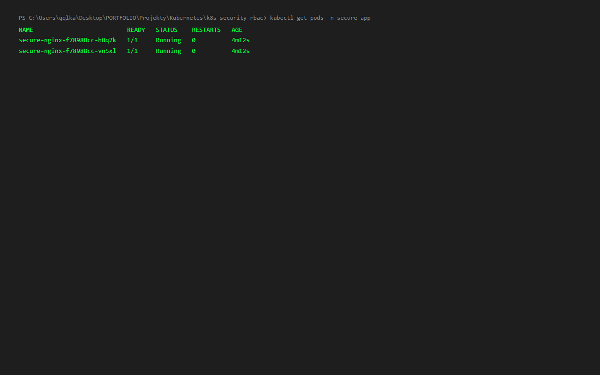

# Kubernetes Security Lab (RBAC, Secrets, NetworkPolicy)

A small nginx deployment on Minikube with the basic Kubernetes security settings applied by hand: its own namespace, a service account with minimal rights, Secrets and ConfigMaps passed in as environment variables, a default deny NetworkPolicy and a CPU-based autoscaler. Everything is plain YAML in `manifests/`.



## What is in the manifests

| File | What it does |
|---|---|
| `namespace.yml` | Namespace `secure-app` for everything below |
| `rbac.yml` | `app-service-account` bound to a Role that can only `get` and `list` pods and configmaps; a separate `viewer-account` with a read only ClusterRole for nodes and namespaces |
| `secret.yml` | `app-secret` with `DB_PASSWORD` and `API_KEY` (example values for the lab) |
| `configmap.yml` | `APP_ENV`, `LOG_LEVEL`, `MAX_CONNECTIONS` |
| `deployment.yml` | nginx 1.25 alpine, 3 replicas, CPU and memory limits, readiness and liveness probes, env from the Secret and ConfigMap |
| `service.yml` | NodePort service on port 80 |
| `networkpolicy.yml` | `deny-all-ingress` for the namespace plus `allow-nginx-ingress` for port 80 on the nginx pods |
| `hpa.yml` | HorizontalPodAutoscaler, 2 to 5 replicas at 70% CPU |

## Run it

You need Minikube, kubectl and Docker.

```bash
git clone https://github.com/OliwierOzgaIT/k8s-runtime-security.git
cd k8s-runtime-security
minikube start --driver=docker
minikube addons enable metrics-server
# the namespace has to exist first, so apply in this order (apply-all.bat does the same on Windows)
for f in namespace rbac secret configmap deployment service networkpolicy hpa; do kubectl apply -f manifests/$f.yml; done
kubectl get all -n secure-app
minikube service secure-nginx-service -n secure-app --url
```

Note: NetworkPolicy is only enforced when the cluster network plugin supports it. To see the deny rule actually block traffic, start Minikube with `--cni=calico`.

Check that the settings work:

```bash
kubectl describe role app-role -n secure-app
kubectl auth can-i delete pods -n secure-app --as=system:serviceaccount:secure-app:app-service-account   # expect "no"
kubectl get networkpolicy -n secure-app
kubectl exec -n secure-app deploy/secure-nginx -- env | grep -E "APP_ENV|LOG_LEVEL"
kubectl get hpa -n secure-app
```

## Problems I ran into

- **Pods stuck in `CreateContainerConfigError`.** The deployment asked for the key `DB_PASS`, but the Secret has `DB_PASSWORD`. `kubectl describe pod` showed the exact message.
- **Pods restarting every minute.** The probes checked `/healthz`, which nginx does not serve, so they got 404. Changing the path to `/` fixed it.
- **HPA showed `cpu: <unknown>/70%`.** Minikube does not run metrics-server by default. Enabling the addon fixed it.

## What I learned

- Reading `kubectl describe` and events first saves a lot of guessing.
- Secrets are only base64 encoded, so access to them has to be limited with RBAC.
- The difference between a Role and a ClusterRole, and how to test permissions with `kubectl auth can-i`.
